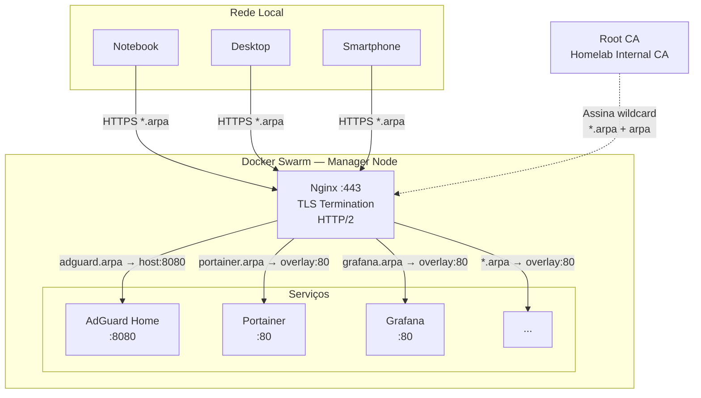
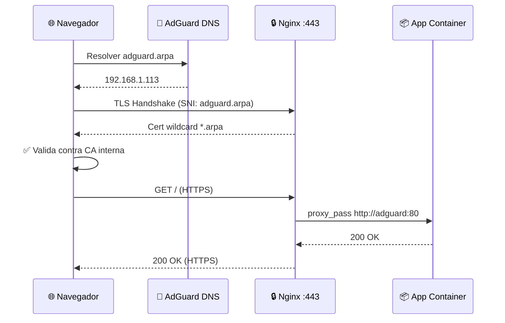

# Homelab GitOps (Docker Swarm)

This repository manages a homelab using GitOps practices with Docker Swarm.

## Goals

- Keep infrastructure as code, versioned in Git.
- Start with core services: AdGuard Home (DNS/DHCP) and Nginx.
- Use `.arpa` local domains with the pattern `<app>.arpa`, where `app` is a placeholder for the service name.
- **HTTPS em todos os serviços** via CA interna e certificado wildcard `*.arpa`.
- Scale by adding new stacks and configurations over time.

## Repository Structure

```
.
|-- certs/                   # Certificados TLS (não versionado — gerado localmente)
|   |-- ca/                  #   Root CA (distribuir ca.crt para dispositivos)
|   |-- wildcard.arpa.*      #   Certificado wildcard *.arpa
|   `-- dhparam.pem          #   Parâmetros DH para Forward Secrecy
|-- configs/
|   |-- adguard/
|   |   `-- AdGuardHome.yaml
|   `-- nginx/
|       |-- apps.wildcard.arpa.conf
|       `-- default.conf
|-- scripts/
|   |-- deploy.sh
|   |-- generate-certs.sh    # Gerar CA interna + wildcard *.arpa
|   |-- update.sh            # Atualizar imagens e reimplantar stacks
|   `-- remove.sh
`-- stacks/
    `-- core/
        |-- .env.example
        `-- docker-stack.yml
```

## Prerequisites

- Docker Engine in Swarm mode (`docker swarm init` on the manager)
- A manager node where the stack can run
- OpenSSL (para gerar certificados)

## Quick Start

1. Copiar template de ambiente se necessário:

   ```bash
   cp stacks/core/.env.example stacks/core/.env
   ```

2. **Gerar certificados TLS** (CA interna + wildcard `*.arpa`):

   ```bash
   ./scripts/generate-certs.sh
   ```

3. Distribuir o certificado da CA para os dispositivos da rede (veja [Internal CA & TLS](#internal-ca--tls)).

4. Subir o stack:

   ```bash
   ./scripts/deploy.sh core
   ```

5. Verificar serviços:

   ```bash
   docker stack services core
   ```

6. Acessar: `https://adguard.arpa`

7. Remover o stack:

   ```bash
   ./scripts/remove.sh core
   ```

## Internal CA & TLS

O homelab opera com uma **CA (Certificate Authority) interna** que assina um certificado wildcard `*.arpa`. Isso elimina avisos de "inseguro" em todos os navegadores, desde que o certificado da CA esteja instalado no dispositivo.

### Arquitetura



### Fluxo de uma requisição



### Gerar certificados

```bash
./scripts/generate-certs.sh
```

Isso cria:

| Arquivo | Propósito |
|---------|-----------|
| `certs/ca/ca.crt` | Certificado da CA — **instalar nos dispositivos** |
| `certs/ca/ca.key` | Chave privada da CA — **manter em segredo** |
| `certs/wildcard.arpa.crt` | Certificado wildcard assinado |
| `certs/wildcard.arpa.key` | Chave privada do wildcard |
| `certs/wildcard.arpa.fullchain.pem` | Cadeia completa (cert + CA) para Nginx |
| `certs/dhparam.pem` | Parâmetros Diffie-Hellman para Forward Secrecy |

### Instalar o CA cert nos dispositivos

**Linux (sistema):**
```bash
sudo cp certs/ca/ca.crt /usr/local/share/ca-certificates/homelab-ca.crt
sudo update-ca-certificates
```

**Linux (Firefox — trust store próprio):**
Preferences → Privacy & Security → View Certificates → Authorities → Import

**Windows:**
Duplo clique em `ca.crt` → Instalar → Trusted Root Certification Authorities

**macOS:**
Duplo clique em `ca.crt` → Keychain → System → Always Trust

**Android:**
Settings → Security → Encryption & Credentials → Install from storage

**iOS:**
Abrir `ca.crt` no Safari → Profile Downloaded → Settings → Install

### Renovar certificados

Os certificados wildcard expiram em 5 anos. Para renovar, basta rodar novamente:

```bash
./scripts/generate-certs.sh   # sobrescreve os certs antigos
./scripts/deploy.sh core      # recarrega o Nginx com os novos certs
```

> ⚠️ O diretório `certs/` contém chaves privadas e **não deve ser versionado** no Git.
> O `.gitignore` já o exclui.

## Atualizar imagens e serviços

Os serviços usam **tags flutuantes** (`latest`, `alpine`, etc.) para que possam ser
atualizados de forma simples. Para atualizar todas as imagens e reimplantar os stacks:

```bash
./scripts/update.sh          # todos os stacks em stacks/
./scripts/update.sh core     # apenas o stack "core"
```

O script faz, para cada stack:

1. `docker pull` das imagens definidas no `docker-stack.yml`;
2. reimplanta o stack via `./scripts/deploy.sh <stack>`.

Como o `docker stack deploy` resolve as tags a cada execução
(`--resolve-image always`), os serviços são recriados com a imagem mais recente.

> Para fixar uma versão específica, troque a tag no `docker-stack.yml`
> (ex.: `nginx:alpine` → `nginx:1.30.5-alpine`). O script continuará funcionando,
> mas só atualizará quando a tag apontada mudar.

## Notes

- AdGuard is configured as a single replica and pinned to a manager node by default.
- DHCP in containers can require network and host-level adjustments depending on your LAN setup.
- The setup wizard is exposed on `https://<node-ip>:3000`.
- AdGuard main UI is exposed on `https://<node-ip>:8080` and proxied by Nginx at `https://adguard.arpa`.
- Use local domains under `.arpa` (pattern: `<app>.arpa`), and avoid `.home`.
- Add future stacks under `stacks/<name>/docker-stack.yml` and deploy with the same script.
- O Nginx faz redirect automático HTTP → HTTPS em todos os domínios `*.arpa`.
- OCSP Stapling está desabilitado (CA interna não tem responder OCSP público).

## Local Domain Pattern

Recommended pattern:

- `<app>.arpa`

`app` is a variable, not a fixed middle label. That means the expected hostnames are `adguard.arpa`, `portainer.arpa`, and `grafana.arpa` instead of `adguard.app.arpa`.

Examples:

- `adguard.arpa`
- `portainer.arpa`
- `grafana.arpa`

Inside AdGuard DNS, create `A` records for these names pointing to the Swarm manager IP.

Nginx wildcard routing uses the left-most label as the upstream service name.
For example, `adguard.arpa` proxies to service `adguard` on port `80`.
## DHCP Migration Plan (Gradual)

1. Keep DHCP on the router for now and use AdGuard only as DNS.
2. Set router DNS to the AdGuard host IP.
3. Validate local records and DNS filtering behavior.
4. Schedule a migration window.
5. Disable router DHCP.
6. Enable DHCP in AdGuard with the same gateway/subnet and a safe IP range.
7. Reboot or renew leases on clients.

Only one DHCP server must be active on the LAN at a time.
